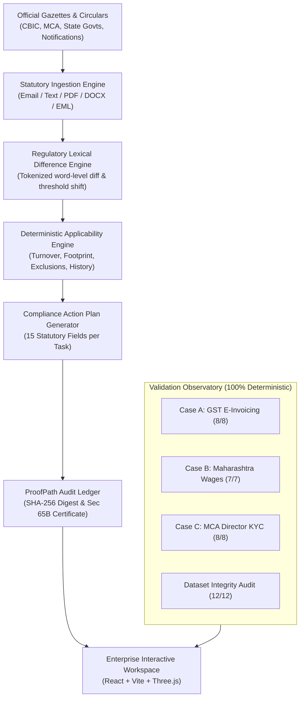

# ReguLens — Enterprise Regulatory Change Impact & Compliance Platform

[](https://fastapi.tiangolo.com/)
[](https://vitejs.dev/)
[](https://threejs.org/)
[-success)](http://localhost:8000/api/tests/member3/all)
[](http://localhost:8000/api/tests/member3/audit)

> **"What Changed, Does It Apply to My Business, and What Exactly Must We Do Next?"**  
> An automated, deterministic regulatory change impact analysis and compliance execution platform engineered for Indian enterprises, MSMEs, corporate legal teams, and compliance officers.

---

## Table of Contents
1. [Platform Overview](#platform-overview)
2. [System Architecture](#system-architecture)
3. [Core Functional Modules](#core-functional-modules)
4. [Statutory Benchmarks & Test Results](#statutory-benchmarks--test-results)
5. [Technology Stack](#technology-stack)
6. [Quickstart & Installation](#quickstart--installation)
7. [API Reference](#api-reference)
8. [Data Security & Credential Management](#data-security--credential-management)

---

## Platform Overview

Indian regulatory frameworks (such as Central GST, the Companies Act, and State Minimum Wage notifications) frequently issue statutory amendments, threshold alterations, and updated compliance mandates. Interpreting these updates manually is error-prone, labor-intensive, and introduces severe non-compliance penalties.

**ReguLens** automates the entire statutory lifecycle:
- **Statutory Parsing**: Ingests raw gazette notifications, government circulars, and email notices in multiple formats (PDF, DOCX, TXT, EML).
- **Lexical Difference Computation**: Computes exact clause-level deletions and insertions between baseline laws and newly enacted amendments.
- **Deterministic Applicability Evaluation**: Evaluates whether an amendment applies to an enterprise based on aggregate turnover, operating jurisdictions, employee headcounts, and statutory exemptions (e.g., SEZ units).
- **Standardized 15-Field Action Planning**: Synthesizes structured, operational compliance tasks with concrete deadlines, statutory citations, and assigned roles.
- **Cryptographic Audit Trail**: Computes SHA-256 digests across inputs, rules, and outcomes to generate tamper-evident compliance certificates aligned with Section 65B of the Indian Evidence Act.

---

## System Architecture



---

## Core Functional Modules

### 1. Statutory Amendment Ingestion & Parsing
- **Email & Text Normalization**: Ingests unstructured notification text, stripping signatures, disclaimers, and email forwarding headers while preserving exact legal clauses, notification numbers, and dates.
- **Multi-Format Document Upload**: Accepts PDF (native and scanned), DOCX, TXT, and raw `.eml` files. Automatically extracts metadata including issuing authority, reference numbers, effective dates, and statutory provisions.

### 2. Lexical Difference & Redline Engine
- Identifies exact textual deletions (redlined) and additions (greenlined) between pre-amendment statutory provisions and enacted notifications.
- Extracts threshold transitions (e.g., turnover limits shifting from ₹10 Crore to ₹5 Crore under CBIC Notification 10/2023-CT).

### 3. Deterministic Applicability Engine
- Evaluates company profiles against statutory rule sets using deterministic logic rather than heuristic approximations.
- Supports multi-parameter criteria:
  - Aggregate PAN-wide annual turnover across consecutive financial years.
  - Multi-state establishment footprints and physical manufacturing units.
  - Statutory exemptions (e.g., SEZ units, banking entities, goods transport agencies under Rule 48(4)).
- Emits a mandatory `Review Required` status whenever baseline evidentiary records (such as historical gazettes or pre-amendment filings) are missing or ambiguous.

### 4. 15-Field Operational Compliance Action Plan
Every generated compliance item includes 15 standardized fields:
1. `action_title`: Concrete task title.
2. `who_should_perform`: Specific organizational role (e.g., Accounts Head, Company Secretary).
3. `why_required`: Legal justification and statutory purpose.
4. `specific_task`: Unambiguous operational instructions.
5. `where_to_complete`: Designated government portal, ERP system, or regulatory portal.
6. `deadline`: Exact calendar due date.
7. `deadline_calculation`: Formula used to calculate the timeline.
8. `documents_required`: Mandatory supporting filings and records.
9. `expected_output`: Verifiable deliverable for internal and statutory audit.
10. `risk_of_missing`: Statutory penalty, interest liability, or operational invalidation.
11. `applicable_provision`: Explicit legal citation.
12. `action_priority`: Critical, High, or Medium priority classification.
13. `completion_status`: Not Started, In Progress, Blocked, or Completed.
14. `assigned_to`: Internal owner assignment.
15. `last_updated`: Timestamp of the latest audit modification.

### 5. ProofPath Cryptographic Audit Trail
- Computes SHA-256 cryptographic digests across amendment parameters, company profiles, applicability outcomes, and generated action items.
- Produces tamper-evident compliance audit records meeting the evidentiary criteria of **Section 65B of the Indian Evidence Act**.

### 6. Multilingual Regulatory Briefings
- Supports localized regional summaries in **English**, **ಕನ್ನಡ (Kannada)**, and **हिन्दी (Hindi)** to enable compliance execution for regional MSMEs.

---

## Statutory Benchmarks & Test Results

The platform includes automated deterministic test suites validating multi-jurisdiction compliance scenarios:

| Suite | Regulatory Domain | Scenarios | Status | Validation Criteria |
| :--- | :--- | :---: | :---: | :--- |
| **Case A** | Central GST E-Invoicing (Rule 48(4)) | 8 / 8 | **100% Passed** | Exact turnover boundary (₹5 Cr) & SEZ exemption tests |
| **Case B** | Maharashtra Minimum Wages (Schedule 26) | 7 / 7 | **100% Passed** | 2004 baseline flagged `Review Required` without gazette |
| **Case C** | MCA Director KYC (Rule 12A) | 8 / 8 | **100% Passed** | Pre-2018 insertion requirement flagged `Review Required` |
| **Dataset Audit** | Cross-Jurisdictional Schema & Dates | 12 / 12 | **100% Passed** | Hash verification, field counts, and date continuity checks |

---

## Technology Stack

- **Backend**:
  - **Framework**: FastAPI (Python 3.10+)
  - **Data Modeling & Validation**: Pydantic v2
  - **Database Integration**: Supabase (PostgreSQL) with deterministic local in-memory fallback
  - **Server Engine**: Uvicorn ASGI
- **Frontend**:
  - **Core**: React 18, TypeScript, Vite
  - **Styling**: Standard CSS with custom design tokens and high-contrast accessibility
  - **3D Graphics**: Three.js for interactive regulatory graph visualization
- **Security & Integrity**:
  - SHA-256 hashing for tamper-evident compliance records
  - Strict environment-level credential isolation

---

## Quickstart & Installation

### Prerequisites
- Python 3.10 or higher
- Node.js 18.x or higher
- Git

### 1. One-Click Startup (Windows)
Run the startup script from the project root:
```powershell
.\start.ps1
```
Or via Command Prompt:
```cmd
start.bat
```

This launches:
- **Backend API Server**: `http://localhost:8000`
- **Frontend Application**: `http://localhost:3000`
- **Swagger Documentation**: `http://localhost:8000/docs`

### 2. Manual Setup

#### Step A: Backend Setup
```bash
# Navigate to backend directory
cd backend

# Install dependencies
python -m pip install -r requirements.txt

# Start the FastAPI service
python -m uvicorn main:app --reload --port 8000
```

#### Step B: Frontend Setup
```bash
# In a separate terminal, navigate to the frontend directory
cd regulens

# Install dependencies
npm install

# Start the Vite development server
npm run dev
```

---

## API Reference

### Health & System Status
- `GET /api/health` — Returns system status, active database mode, and available endpoints.

### Amendment Ingestion & Analysis
- `POST /api/amendments/analyze-text` — Ingests pasted email or circular text, extracts metadata, and generates applicability assessments.
- `POST /api/amendments/upload` — Uploads and processes PDF, DOCX, TXT, or EML notification files.
- `GET /api/amendments` — Retrieves all ingested amendments and status records.

### Compliance Action Plans
- `GET /api/action-plans/{amendment_id}` — Retrieves the 15-field compliance action plan for an amendment.
- `PATCH /api/action-plans/{amendment_id}/items/{item_id}` — Updates status, assignment, or completion notes for an action item.
- `GET /api/action-plans/{amendment_id}/export` — Exports the complete action plan to CSV or JSON format.

### ProofPath Cryptographic Audit
- `GET /api/proofpath/records` — Lists all tamper-evident compliance records.
- `POST /api/proofpath/generate` — Computes a SHA-256 digest and creates a new compliance audit record.
- `GET /api/proofpath/verify/{record_id}` — Verifies the cryptographic integrity of a compliance certificate.

### Statutory Benchmark Test Suites
- `GET /api/tests/case-a` — Executes the 8/8 GST E-Invoicing scenario benchmark.
- `GET /api/tests/case-b` — Executes the 7/7 Maharashtra Minimum Wages benchmark.
- `GET /api/tests/case-c` — Executes the 8/8 MCA Director KYC benchmark.
- `GET /api/tests/member3/all` — Runs all multi-case benchmark suites.
- `GET /api/tests/member3/audit` — Validates cross-jurisdiction schemas and dataset files.

---

## Data Security & Credential Management

- **Zero Credential Exposure**: No API keys, database credentials, or secret tokens are tracked in version control. All live secrets are isolated in local `.env` files protected by `.gitignore`.
- **Sanitized Templates**: The repository provides [`.env.example`](file:///d:/Hackathon/.env.example) and [`backend/.env.example`](file:///d:/Hackathon/backend/.env.example) with blank placeholders for deployment setup.
- **Offline Resilience Mode**: The platform includes a deterministic local data engine, allowing full execution of all features and benchmark evaluations without external network dependencies.
